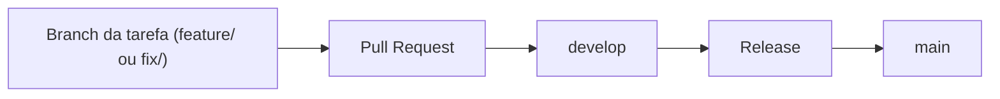

# Como contribuir

Resumo:

- Cada tarefa tem uma issue e uma branch própria, criada a partir da `develop`.
- Commits seguem o formato `tipo(escopo): descrição`, em português.
- O Pull Request vai sempre para a `develop`, nunca direto para a `main`.
- Um colega revisa o PR, e Luiz Antonio dá a aprovação final na issue.
- A `main` só recebe código por meio de uma release criada a partir da `develop`.

Nenhuma ferramenta bloqueia commits ou branches fora do padrão. As regras são combinadas entre a equipe e conferidas na revisão de cada Pull Request.

## Commits

Um commit é um registro de uma mudança no código, com uma mensagem que explica o que foi feito.

### Formato

```text
tipo(escopo): descrição
```

### Tipos

Use apenas estes seis tipos:

| Tipo | Quando usar | Exemplo |
| --- | --- | --- |
| `feat` | Nova funcionalidade | `feat(front): cria página de cursos` |
| `fix` | Correção de bug | `fix(back): corrige erro ao iniciar o servidor` |
| `chore` | Manutenção, configuração, documentação e tarefas gerais | `chore(docs): atualiza README` |
| `hotfix` | Correção urgente | `hotfix(back): corrige falha crítica no login` |
| `build` | Build, Docker e dependências | `build(docker): ajusta imagem de produção do front` |
| `delete` | Remoção de código, arquivos ou funcionalidades | `delete(front): remove componente sem uso` |

Documentação entra como `chore(docs)`.

### Escopo

O escopo vai entre parênteses. Ele é curto e indica o ambiente ou a tarefa: `(front)`, `(back)`, `(docs)`, `(docker)`.

### Descrição

- Em português e em letras minúsculas.
- Sem ponto final.
- Curta: até cerca de 72 caracteres.
- Diz o que foi feito.

## Branches

Uma branch é uma linha de trabalho separada, onde você muda o código sem afetar o trabalho dos outros.

- `main`: representa a produção (o que está publicado).
- `develop`: branch de integração. Todo trabalho entra aqui primeiro.

Cada tarefa começa em uma branch nova, criada a partir da `develop`, com o nome `tipo/nome-da-tarefa`. Os prefixos seguem os tipos de commit:

| Prefixo da branch | Tipo de commit | Exemplo |
| --- | --- | --- |
| `feature/` | `feat` | `feature/pagina-de-cursos` |
| `fix/` | `fix` | `fix/erro-no-login` |
| `chore/` | `chore` | `chore/atualiza-readme` |
| `hotfix/` | `hotfix` | `hotfix/falha-no-login` |
| `build/` | `build` | `build/imagem-de-producao` |
| `delete/` | `delete` | `delete/componente-sem-uso` |

O nome da tarefa fica em minúsculas, sem acentos, com hífens no lugar dos espaços, curto e descritivo.

## Fluxo de uma tarefa



1. Cada tarefa tem uma issue. Pegue uma e crie a branch a partir da `develop` atualizada:

   ```bash
   git checkout develop
   git pull
   git checkout -b feature/pagina-de-cursos
   ```

2. Faça commits pequenos, no padrão acima.
3. Ao terminar, abra um Pull Request (PR) **sempre para a `develop`**, nunca direto para a `main`. Descreva o que foi feito e referencie a issue da tarefa.
4. Revisão: o ideal é sempre um colega revisar o que o outro fez. Ninguém aprova o próprio PR. O prazo de revisão é rápido e definido em cada sprint, para ninguém ficar travado esperando.
5. Aprovação final: Luiz Antonio dá a aprovação final na issue relacionada à tarefa.
6. Com a aprovação, o PR é integrado na `develop`.

## Release

Quando a `develop` estiver pronta, é criada uma release (uma versão do projeto) a partir dela. Essa release é levada para a `main`, que é a produção. Exemplo de nome de release: `v1.0.0`.

## Checklist do Pull Request

O workflow [Routine checks](.github/workflows/ci.yml) executa lint, conferência de formatação e build no front-end e no back-end, além dos testes unitários e de ponta a ponta do back-end. Ele roda em pull requests e pushes para `develop` e `main`. Também pode ser iniciado manualmente pela aba **Actions**, em **Routine checks → Run workflow**. Usa Node.js 26, como os Dockerfiles, e instala as versões dos arquivos `package-lock.json` com `npm ci`.

Antes de pedir revisão, confira:

- [ ] Nas pastas que você alterou (`frontend/` e/ou `backend/`), estes comandos passam sem erro:

  ```bash
  npm run lint
  npm run format:check
  npm run build
  ```

- [ ] Se alterou o `backend/`, os testes passam com `npm test`.
- [ ] A issue da tarefa está referenciada na descrição do PR.
- [ ] Um revisor está marcado no PR.

Voltar para o [README](README.md).
