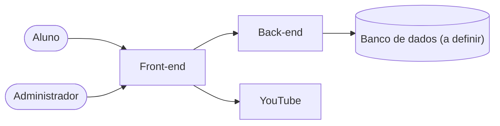

<div align="center">

# Portal do Allicode

Site institucional e plataforma de cursos do Allicode, projeto de extensão do IES/IEEE da UFCIRJ.

<p>
  
  
  
  
  
  
</p>

</div>

**Sumário:**
[O que é o Allicode](#o-que-é-o-allicode) ·
[Qual problema o portal resolve](#qual-problema-o-portal-resolve) ·
[O que é o Portal do Allicode](#o-que-é-o-portal-do-allicode) ·
[Início rápido](#início-rápido) ·
[O que não faz nesta versão](#o-que-não-faz-nesta-versão) ·
[Status do projeto](#status-do-projeto) ·
[Como o projeto é organizado](#como-o-projeto-é-organizado) ·
[Como rodar o projeto localmente](#como-rodar-o-projeto-localmente) ·
[Como contribuir](#como-contribuir) ·
[Equipe](#equipe)

## O que é o Allicode

O Allicode é um projeto de capacitação em tecnologia do IES/IEEE da UFCIRJ (antigo CEFET/RJ). Ele apresenta a pessoas com pouco ou nenhum conhecimento prévio os fundamentos de diferentes áreas da tecnologia, com formação prática e acessível.

As turmas anteriores passaram por Frontend (HTML, CSS, JavaScript e React), Mobile com integração a APIs (Ionic), Engenharia de Dados e Inteligência Artificial. Nessas turmas, os alunos construíram projetos reais: um sistema de lista de tarefas, um aplicativo inspirado na Steam e um Data Warehouse com dados históricos da Copa do Mundo.

## Qual problema o portal resolve

Hoje, o conteúdo das capacitações (vídeo-aulas, materiais de apoio e exercícios) está espalhado em vários canais. Não existe um lugar único onde o aluno encontre tudo.

## O que é o Portal do Allicode

É um site que reúne a apresentação do Allicode e a lista de cursos, organizados em módulos.

Em cada aula, o aluno:

- vê uma prévia do vídeo, que o leva ao YouTube (onde o vídeo realmente fica);
- encontra o material em PDF;
- acessa o link do repositório de código da aula;
- faz mini exercícios para testar o que aprendeu.

O aluno se cadastra e acompanha seu progresso em cada curso. A equipe do Allicode mantém todo o conteúdo por um painel administrativo.

## Início rápido

Para quem só quer ver o projeto rodando. Você precisa ter o Git e o Docker instalados (veja os [pré-requisitos](#pré-requisitos)).

```bash
git clone https://github.com/iescefetrj/Portal-Allicode.git
cd Portal-Allicode
docker compose up --build
```

Depois, abra http://localhost:5173 no navegador. O passo a passo completo está em [Como rodar o projeto localmente](#como-rodar-o-projeto-localmente).

## O que não faz nesta versão

- Não hospeda vídeos: eles ficam no YouTube.
- Não cobra pagamentos.
- Não emite certificados.
- Não corrige exercícios automaticamente.
- Não tem login por redes sociais.

## Status do projeto

> [!NOTE]
> O projeto está em desenvolvimento e é construído em sprints (ciclos curtos de trabalho, com tarefas definidas para cada ciclo). As funcionalidades descritas acima ainda estão sendo construídas.

O que já existe hoje é a base técnica:

- **Front-end:** projeto React + Vite + TypeScript com rotas provisórias (Home, Cursos, Login e página de "não encontrada"), ainda sem conteúdo real.
- **Back-end:** projeto NestJS inicial, que por enquanto só responde "Hello World!".
- **Docker:** arquivos para subir front e back com um único comando, em modo de desenvolvimento e em modo de produção.

Cadastro, cursos, progresso do aluno e painel administrativo ainda não foram construídos. O banco de dados também ainda não foi escolhido.

## Como o projeto é organizado

O projeto tem duas partes. O **front-end** é a parte visual: o site que a pessoa vê e clica no navegador. O **back-end** é a parte que guarda e entrega os dados para o front-end, por meio de uma API (um conjunto de endereços que o front-end chama para pedir ou enviar informações).



*Visão geral do que o portal fará. O aluno e o administrador usam o front-end, que conversa com o back-end. Os vídeos ficam no YouTube. O banco de dados ainda será definido pela equipe.*

### Tecnologias

| Tecnologia | Versão | Onde | Para que serve |
| --- | --- | --- | --- |
| [React](https://react.dev/) | 19 | front-end | Biblioteca para construir a interface do site |
| [Vite](https://vite.dev/) | 8 | front-end | Servidor de desenvolvimento e geração do build |
| [React Router](https://reactrouter.com/) | 7 | front-end | Navegação entre as páginas do site |
| [Axios](https://axios-http.com/) | 1 | front-end | Chamadas do front-end para a API |
| [NestJS](https://nestjs.com/) | 12 | back-end | Framework para construir a API |
| [Vitest](https://vitest.dev/) | 4 | back-end | Testes automatizados |
| [TypeScript](https://www.typescriptlang.org/) | 7 (front), 6 (back) | os dois | JavaScript com tipos, que ajuda a evitar erros |
| [Oxlint](https://oxc.rs/docs/guide/usage/linter.html) | 1 | os dois | Lint: aponta problemas no código |
| [Prettier](https://prettier.io/) | 3 | os dois | Formata o código no mesmo padrão |
| [Docker](https://www.docker.com/) | - | os dois | Roda o projeto em containers, igual em qualquer máquina |
| [nginx](https://nginx.org/) | - | front-end | Serve o site na imagem de produção |

### Estrutura de pastas

```text
Portal-Allicode/
├── backend/                  # back-end (API em NestJS)
│   ├── src/                  # código-fonte
│   ├── test/                 # testes de ponta a ponta (e2e)
│   ├── .env.example          # modelo das variáveis de ambiente
│   ├── Dockerfile
│   └── package.json
├── frontend/                 # front-end (site em React + Vite)
│   ├── public/               # arquivos estáticos
│   ├── src/
│   │   ├── pages/            # páginas do site
│   │   ├── routes/           # rotas e layout
│   │   └── services/         # comunicação com a API (Axios)
│   ├── .env.example          # modelo das variáveis de ambiente
│   ├── Dockerfile
│   ├── nginx.conf            # configuração do servidor de produção
│   └── package.json
├── docker-compose.yml        # ambiente de desenvolvimento
├── docker-compose.prod.yml   # imagens de produção, para testar localmente
├── CONTRIBUTING.md           # regras de commit, branch e Pull Request
└── README.md
```

Cada parte tem seu próprio README: [frontend/README.md](frontend/README.md) e [backend/README.md](backend/README.md).

## Como rodar o projeto localmente

Existem duas formas de rodar o projeto:

- **Opção A, com Docker (recomendada).** Só precisa de Git e Docker. O Docker cria containers, que são ambientes isolados com tudo o que o projeto precisa. Assim, o projeto roda igual em qualquer máquina.
- **Opção B, sem Docker.** Precisa de Git e Node.js (o programa que executa JavaScript fora do navegador). Útil para quem prefere rodar tudo direto na máquina.

Os comandos abaixo são digitados em um terminal (a janela de linha de comando do sistema).

### Pré-requisitos

| Sistema | Opção A (Docker) | Opção B (sem Docker) |
| --- | --- | --- |
| Windows | [Git for Windows](https://git-scm.com/downloads/win) e [Docker Desktop](https://docs.docker.com/desktop/setup/install/windows-install/) com WSL 2 | Git for Windows e [Node.js 26 (LTS)](https://nodejs.org/) |
| Linux | [Git](https://git-scm.com/downloads/linux) e [Docker Engine com o plugin Compose](https://docs.docker.com/engine/install/) | Git e Node.js 26 (LTS), via [nvm](https://github.com/nvm-sh/nvm) ou gerenciador da distribuição |
| macOS | [Git](https://git-scm.com/downloads/mac) e [Docker Desktop](https://docs.docker.com/desktop/setup/install/mac-install/) | Git e Node.js 26 (LTS), via [Homebrew](https://brew.sh/) ou nvm |

Use o **Node.js 26**, a mesma versão usada nos Dockerfiles. LTS significa versão com suporte de longo prazo.

> [!WARNING]
> No Windows, o Docker Desktop depende do WSL 2 (o subsistema do Windows que roda Linux). Sem ele, os containers não sobem. Veja como ativar na [documentação da Microsoft](https://learn.microsoft.com/pt-br/windows/wsl/install).

<details>
<summary><strong>Windows</strong></summary>

1. Instale o [Git for Windows](https://git-scm.com/downloads/win). Ele já traz o Git Bash, um terminal parecido com o do Linux.
2. Ative o WSL 2: abra o PowerShell como administrador e rode `wsl --install`. Reinicie o computador.
3. Instale o [Docker Desktop](https://docs.docker.com/desktop/setup/install/windows-install/) e deixe marcada a opção de usar o WSL 2.
4. Para a opção B, instale o Node.js 26 (LTS) pelo [instalador oficial](https://nodejs.org/).

Rode os comandos no **PowerShell** ou no **Git Bash**. Quando o comando for diferente entre eles, este guia mostra as duas versões.

</details>

<details>
<summary><strong>Linux</strong></summary>

1. Instale o Git pelo gerenciador de pacotes da sua distribuição. No Ubuntu e no Debian: `sudo apt install git`.
2. Instale o Docker Engine e o plugin Compose seguindo as [instruções oficiais para a sua distribuição](https://docs.docker.com/engine/install/).
3. Para usar o Docker sem `sudo`, adicione seu usuário ao grupo `docker` e depois saia e entre de novo na sessão:

   ```bash
   sudo usermod -aG docker $USER
   ```

   Mais detalhes nos [passos pós-instalação](https://docs.docker.com/engine/install/linux-postinstall/).
4. Para a opção B, instale o Node.js 26 (LTS) pelo [nvm](https://github.com/nvm-sh/nvm) ou pelo gerenciador da distribuição. Com o nvm:

   ```bash
   nvm install 26
   ```

</details>

<details>
<summary><strong>macOS</strong></summary>

1. Instale o Git com as Xcode Command Line Tools (`xcode-select --install`) ou com o [Homebrew](https://brew.sh/) (`brew install git`).
2. Instale o [Docker Desktop](https://docs.docker.com/desktop/setup/install/mac-install/) e abra o aplicativo.
3. Para a opção B, instale o Node.js 26 (LTS) com o [nvm](https://github.com/nvm-sh/nvm) (`nvm install 26`) ou com o [Homebrew](https://formulae.brew.sh/formula/node), escolhendo a versão 26.

</details>

Para conferir a instalação, rode:

```bash
git --version
docker --version
docker compose version
node -v   # só para a opção B
npm -v    # só para a opção B
```

Cada comando deve mostrar um número de versão. O `node -v` deve começar com `v26`.

### Opção A: com Docker

> [!TIP]
> No Windows, rode `git config --global core.autocrlf input` **antes** de clonar. Isso evita que os arquivos sejam baixados com fim de linha do Windows (CRLF), o que faz o `format:check` falhar.

1. Clone o repositório (baixe uma cópia dele) e entre na pasta:

   ```bash
   git clone https://github.com/iescefetrj/Portal-Allicode.git
   cd Portal-Allicode
   ```

2. Suba o front-end e o back-end. Na primeira vez, o Docker baixa as imagens e instala as dependências, o que leva alguns minutos:

   ```bash
   docker compose up --build
   ```

   Nesta opção não é preciso criar o arquivo `.env`: o `docker-compose.yml` já define a variável `VITE_API_URL`.

3. Abra no navegador:

   | Parte | Endereço |
   | --- | --- |
   | Front-end | http://localhost:5173 |
   | Back-end | http://localhost:3000 |

O ambiente tem hot reload: quando você salva um arquivo, a mudança aparece sozinha, sem reiniciar nada.

Comandos úteis (rode em outro terminal, na pasta do projeto):

```bash
# ver os logs (mensagens) dos dois serviços
docker compose logs -f

# ver os logs de um serviço só
docker compose logs -f front
docker compose logs -f back

# parar tudo (ou Ctrl+C no terminal onde o compose está rodando)
docker compose down

# reconstruir depois de mudar um Dockerfile ou um package.json
docker compose up --build --renew-anon-volumes
```

O `--renew-anon-volumes` recria a pasta `node_modules` dentro dos containers. Use quando alguma dependência mudar.

**Testar as imagens de produção.** O arquivo `docker-compose.prod.yml` gera as imagens finais, sem hot reload. Rode `docker compose -f docker-compose.prod.yml up --build` e abra o front-end em http://localhost:8080 e o back-end em http://localhost:3000. Para parar, use `docker compose -f docker-compose.prod.yml down`. Como os dois ambientes usam a porta 3000, pare um antes de subir o outro.

### Opção B: sem Docker

Clone o repositório como no passo 1 da opção A. Depois, abra **dois terminais**, os dois na pasta `Portal-Allicode`.

**Terminal 1: back-end**

```bash
cd backend
npm install
npm run start:dev
```

O back-end fica disponível em http://localhost:3000.

**Terminal 2: front-end**

Primeiro, copie o arquivo de exemplo das variáveis de ambiente para `.env`.

No Linux, no macOS ou no Git Bash:

```bash
cd frontend
cp .env.example .env
```

No PowerShell:

```powershell
cd frontend
copy .env.example .env
```

Depois, instale as dependências e suba o servidor:

```bash
npm install
npm run dev
```

O front-end fica disponível em http://localhost:5173.

### Como confirmar que deu certo

- **No navegador**, em http://localhost:5173, aparece o título "Portal do Allicode" e os links Home, Cursos e Login. Em http://localhost:3000 aparece o texto "Hello World!".
- **No terminal**, o Vite mostra o endereço `http://localhost:5173/` e o NestJS mostra a mensagem `Nest application successfully started`.

<details>
<summary><strong>Problemas comuns</strong></summary>

- **Erro ao conectar com o Docker** (por exemplo, `Cannot connect to the Docker daemon`). No Windows e no macOS, o Docker Desktop precisa estar aberto. Abra o aplicativo, espere ele terminar de iniciar e rode o comando de novo.
- **Porta já em uso** (`port is already allocated` ou `EADDRINUSE`). Outro programa está usando a porta 5173, 3000 ou 8080. Feche esse programa ou pare o outro ambiente do projeto. Para descobrir quem usa a porta: `lsof -i :3000` no Linux e no macOS, ou `netstat -ano | findstr :3000` no PowerShell.
- **WSL 2 não habilitado no Windows.** O Docker Desktop avisa que o WSL 2 não está instalado ou não inicia. Rode `wsl --install` no PowerShell como administrador e reinicie o computador.
- **`format:check` falha no Windows em quase todos os arquivos.** Os arquivos foram baixados com fim de linha do Windows (CRLF), mas o projeto usa o padrão LF. Rode `git config --global core.autocrlf input` e clone o repositório de novo.
- **`permission denied` ao usar o Docker no Linux.** Seu usuário não está no grupo `docker`. Rode `sudo usermod -aG docker $USER`, saia e entre de novo na sessão.

</details>

## Como contribuir

Cada tarefa é feita em uma branch própria (uma linha de trabalho separada), criada a partir da `develop`. Ao terminar, você abre um Pull Request (pedido para juntar seu trabalho ao projeto) para a `develop`, e um colega revisa antes da integração. As regras completas de commits, branches e Pull Requests estão no [CONTRIBUTING.md](CONTRIBUTING.md).

## Equipe

### Versão 1.0

A versão 1.0 foi feita por:

- Luiz Antonio
- Rebecca Veltri
- João Fróes
- Marco Antonio
- Felipe Cavallo
- William Faustino
- Darlan Barbosa
- Gabriel Baptista

---

<p align="center"><sub>Projeto de extensão do IES/IEEE · UFCIRJ</sub></p>
